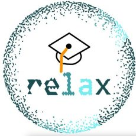

# Invitation

{ align=right width=250 }

**Location:** Aarhus University Conference Center,  Fredrik Nielsens Vej 2-4, 8000 Aarhus C
[https://maps.app.goo.gl/dn93Ddq1HCf9u5fq6](https://maps.app.goo.gl/dn93Ddq1HCf9u5fq6)

We cordially invite you to the final RELAX Public Workshop that is organized at Aarhus University on 12-13 November 2026. On-line participation will be possible for the PhD student talks.

RELAX is a four-year project where 12 PhD-students have performed research that enables them to be experts in the design of scalable and efficient data-intensive software systems. Read more about all research here: http://www.relax-dn.eu/  

We would be delighted if you could join the Public Workshop that will include the following:  

* Short PhD student presentations (pitches) on their respective research projects aimed at informed non-specialists in the field. 

* Two keynote talks from industry experts in the field from Uber and Crodulus. 

* Opportunities for informal talks about the research with the individual PhD-students, their supervisors and other stakeholders that join us.

If you are considering to attend **[please register](https://event.au.dk/events/relax-workshop)** to make our preparations easier.

We look forward to welcoming you in Aarhus!